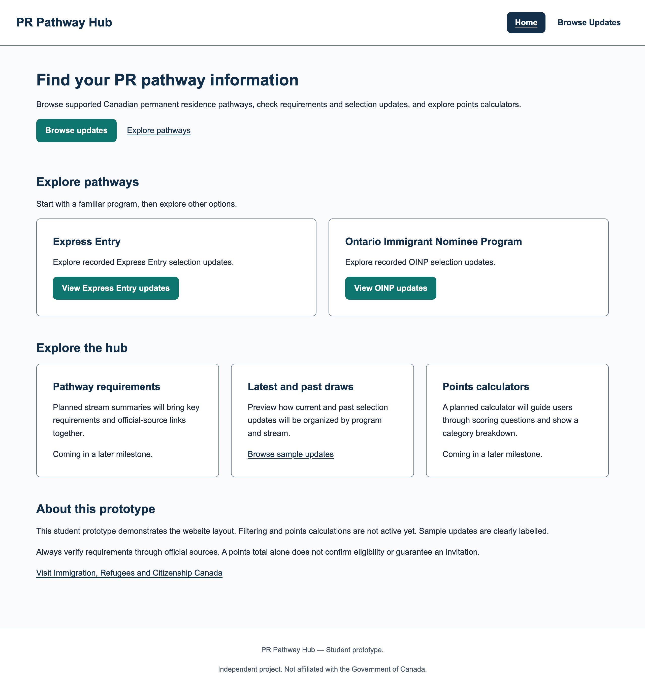

# YOUR PROJECT NAME

> Replace this stub in Part 8. It must include: the project name and tagline, the problem in one or two sentences, a screenshot of your home page, how to view the site, what is built so far and what comes next (link your open issues), your folder structure, and the tools you used.

**Tagline:** YOUR TAGLINE

## The problem

YOUR ANSWER HERE

## Screenshot

## How to view it

YOUR ANSWER HERE

## What is built, and what comes next

YOUR ANSWER HERE

## Folder structure

YOUR ANSWER HERE

## Tools used

YOUR ANSWER HERE
