# Studio Project 1, Milestone 1: Project Notebook

> **How to use this notebook.** Replace every line that says `YOUR ANSWER HERE` (and delete the grey instruction lines that start with `>`) with your own work. Keep the headings. Commit after each part. Do not leave any instruction text in your final version.

**Student name:** Rishabh Bhutani
**GitHub username:** rishabhssworld

> This notebook is my own individual work. I did my own research, sketches, writing and code.

---

## Part 0: Project Snapshot

**Project name:** PR Pathway Hub
**Tagline (10 words or fewer):** Find immigration updates and calculate pathway points.
**Repository link:** https://github.com/rishabhssworld/studio-project-1

**Idea check** (write yes or no, and one short reason for each):

| # | Question | Yes or no, and why |
|---|---|---|
| 1 | A real group of people has this problem, and I can talk to some of them | Yes. People exploring Canadian permanent residence pathways face this problem. I can speak with two people who have searched for this information. |
| 2 | Users do something in the app (not just read) | Yes. Users will filter selection updates by program and stream, and calculate points for supported streams. |
| 3 | The app needs to remember things | Yes. It will store programs, streams, selection updates and scoring criteria.|
| 4 | I can describe the first version in one sentence | Yes. The first version brings selection updates and a points calculator for one supported stream into one place.|
| 5 | I can picture at least three screens | Yes. Home, Browse Updates, and Points Calculator. |
| 6 | I alone could build a simple first version | Yes. I will start with a small set of programs and one calculator, then expand later.|

**My one-sentence description of the first version:** PR Pathway Hub will help users find relevant Canadian permanent residence pathway information, browse selection updates, and calculate points for supported streams.

---

## Part 1: Define the Problem

### 1.1 Problem statement
>People exploring Canadian permanent residence pathways struggle to find relevant program information, selection updates and scoring criteria because these details are spread across different websites, pages and documents. Finding the requirements and latest updates for a particular stream often involves opening several links and scrolling through unrelated information. Some scoring criteria also require users to read tables and manually calculate their points. This makes the process time-consuming and can lead to missed information or calculation mistakes.

YOUR ANSWER HERE

### 1.2 Evidence from real people
> Two short conversations. Record a role (not a full name), two exact quotes each, and one surprise. Ask permission before quoting. Do not invent quotes.

**Conversation A**

- **Who (role only):**  Former international student who completed two one-year certificate programs in Canada.
- **Quote 1:** "It is difficult to locate exactly what I need on the official website."
- **Quote 2:** "There's a CRS score calculator for express entry I would like the same for OINP, it would make things very easy for all the candidates, as while calculating our own we make mistakes sometimes."
- **What surprised me:** The main concern was understanding whether his education met the eligibility requirements. Calculating points manually was manageable, but answering questions with radio buttons would have been more convenient on a phone.

**Conversation B**

- **Who (role only):** Work permit holder researching permanent residence pathways.
- **Quote 1:** "I want to see the requirements and recent draws for the same stream without opening several pages."
- **Response summary (paraphrased):** He wanted requirements and recent draw results for a stream in one place. He also preferred a calculator that explains how each answer contributes to the total score.
- **Quote 2:** "A calculator that explains where each point comes from would help me understand my total."
- **What surprised me:** I expected him to mainly want a final score, but he also wanted to understand how each answer contributed to his points.

**Revised problem statement** (re-read 1.1 after your conversations, then write the revised version, or write "no change" and say why):


People exploring Canadian permanent residence pathways struggle to find relevant requirements, selection updates and scoring criteria because the information is spread across different pages and documents. Finding details for a particular stream often requires opening several links and scrolling through unrelated content. Manually calculating points can also lead to mistakes, especially on a phone. Users need to understand both their total points and how each answer contributes to that total.


### 1.3 Persona
> A made-up person based on what you heard. Their frustrations should echo your quotes.

- **Name, age or life stage, role:** Aman, 25, a former international student who now holds a work permit.
- **Context (when and where the problem happens):** Aman researches permanent residence pathways on his phone after work. He wants to understand which streams match his education and work experience.
- **Three goals:** 1) Find the requirements for a specific stream. 2) Check recent draws and selection updates. 3) Calculate his points and understand the breakdown.
- **Three frustrations:** 1) Opening several pages to find relevant information. 2) Reading scoring tables in PDFs on his phone. 3) Manually adding points and worrying about mistakes.
- **Technology comfort and devices:** Medium. He is comfortable browsing websites and completing online forms, mainly using his smartphone.
- **A quote that sums them up:** “I want to find the requirements and understand my points without jumping between pages.”

### 1.4 What already exists
> Two or three alternatives, including "doing it by hand" if that is what people really do.

| Alternative | What it does well | Where it falls short for my persona |
|---|---|---|
| Official immigration websites | Provide information directly from the authorities responsible for each pathway. | In our search, finding the relevant stream requirements and scoring information involved opening several links and scrolling through pages. |
| PDF scoring sheets and a phone calculator | Let users read the scoring criteria and manually calculate their points. | Switching between the PDF and calculator on a phone is inconvenient, and manual addition can lead to mistakes. |
| Asking friends who have researched PR pathways | Provides a familiar starting point and lets users ask questions. | Their experiences may involve different circumstances, so Aman still needs to check the official requirements for himself. |

### 1.5 Success criteria
> Three statements you could actually check.

1. At least four out of five test users can find a selected stream’s requirements and official-source link within one minute.

2. At least four out of five test users can find the latest recorded selection update for a chosen stream within three clicks from the Home page.

3. For the first supported points calculator, all five prepared test cases produce the expected total and category breakdown calculated from the official scoring criteria.

### 1.6 Abstract (150 to 250 words)
> Three short parts: the problem and who has it, what you are building, and why it matters.

People exploring Canadian permanent residence pathways often need to check program requirements, recent selection updates and scoring criteria. This information can be difficult to locate when it is spread across different pages and documents. In conversations with potential users, finding stream-specific information and manually calculating points on a phone were concerns. Users also wanted to understand how their answers contributed to their total points.

PR Pathway Hub is a planned website that brings these tasks together. Users will choose a program and stream to view a concise requirements summary, current and past selection updates and links to official sources. A guided points calculator will initially support one stream and show both the total score and a category breakdown. The first milestone will provide a responsive Home page and Browse Updates page using HTML and CSS. Working filters, calculations and data storage will be added in later milestones.

The project aims to reduce the time spent navigating between pages and make scoring information easier to understand on mobile devices. Its initial scope will remain small so that information and scoring rules can be checked against official sources. Calculated points will be presented separately from eligibility requirements, since a points total alone does not establish eligibility or guarantee an invitation.

**Word count:** 208

---

## Part 2: Decide What to Build

### 2.1 Scope (MoSCoW)
> At most five Musts, each with a "because" tied to a success criterion. At least two Won'ts. Ten to fourteen features in total.

| Feature | Group (Must, Should, Could, Won't) | Because |
|---|---|---|
| Feature | Group (Must, Should, Could, Won't) | Because |
|---|---|---|
| Browse supported programs and streams | Must | Users need to locate a specific stream to meet success criterion 1. |
| View concise stream requirements with official-source links | Must | Users need to find requirements and verify their source within one minute, as measured by success criterion 1. |
| View selection updates organized by program and stream | Must | Users need to find the latest recorded update within three clicks, as measured by success criterion 2. |
| View current and past selection updates organized by program and stream | Must | Users need to find the latest recorded update within three clicks, as measured by success criterion 2, and browse previous results for context. |
| Calculate points for one supported stream | Must | The calculator must produce the expected totals for the test cases in success criterion 3. |
| View a category breakdown of calculated points | Must | Users need to understand where their points come from, and the breakdown must match success criterion 3. |
| Show when pathway information was last checked | Should | Users should be able to judge how recently the information was reviewed. |
| Filter updates by date | Should | This would help users narrow a longer list of updates. |
| Save favourite streams on the device | Could | This would make repeat visits more convenient. |
| Compare two streams side by side | Could | This could help users explore differences after reading individual stream details. |
| Send notifications about new updates | Won't | Notifications add complexity beyond this term's scope. |
| Predict future draw dates or cutoff scores | Won't | Reliable predictions require data and evaluation beyond this project's scope. |
| Support calculators for every Canadian PR stream | Won't | Each scoring system requires separate implementation and verification, so the first version will support one. |

### 2.2 Main user flow
> Five to eight numbered steps, each naming the screen where it happens.

1. Aman opens the Home page and selects “Explore pathways.”
2. On the Browse Updates page, he chooses a supported program and stream.
3. On the Browse Updates page, he views the latest recorded draw or selection update, then browses past results for that stream.
4. On the Stream Details page, he reads the requirements summary and follows the official-source link if he needs more detail.
5. He selects “Calculate my points” and opens the Points Calculator page for the supported stream.
6. On the Points Calculator page, he answers the scoring questions and selects “Show my score.”
7. On the Points Calculator page, he reviews his total and category breakdown, understanding that the score alone does not confirm eligibility or guarantee an invitation.

### 2.3 Data sketch
> Two to four things your app remembers, with three to five details each. No SQL. Then one sentence for each relationship.

| Thing | Details it remembers |
|---|---|
| Program | Program name, province or region, description, official-source link |
| Stream | Parent program, stream name, requirements summary, official-source link, last-checked date |
| Selection update | Related stream, selection date, invitations issued if published, cutoff score if applicable, official-source link |
| Scoring criterion | Related stream, category name, question text, answer options with their points, official-source link |

**Relationships:**

- A program can contain several streams.
- A stream can have many selection updates, including current and past draws.
- A stream can have several scoring criteria.
- Each scoring criterion provides a question and answer options used by that stream’s points calculator.

### 2.4 Page list
> Every page the finished project might have (at least five). Mark the two you build in this milestone.

| Page | Purpose | Built in Milestone 1? |
|---|---|---|
| Home | | Yes |
| Home | Introduce the website and guide users to pathway information, selection updates and calculators. | Yes |
| Browse Updates | Let users choose a program and stream, and browse current and past draws or selection updates. | Yes |
| Stream Details | Show a stream’s requirements summary, official-source links, last-checked date and relevant calculator link. | No |
| Points Calculator | Ask scoring questions for a supported stream and display the total with a category breakdown. | No |
| About and Sources | Explain the website’s scope, sources, update process and the difference between points and eligibility. | No |

### 2.5 GitHub issues
> Paste the links to your five issues.

1. Build the home page and the core page (HTML): https://github.com/rishabhssworld/studio-project-1/issues/1
2. Style the site: palette, responsive layout and components: https://github.com/rishabhssworld/studio-project-1/issues/2
3. Feature: browse current and past selection updates: https://github.com/rishabhssworld/studio-project-1/issues/3
4. Feature: view stream requirements and official sources: https://github.com/rishabhssworld/studio-project-1/issues/4
5. Feature: calculate points with a category breakdown: https://github.com/rishabhssworld/studio-project-1/issues/5

### 2.6 Abstract check
> Re-read your abstract from 1.6 against your Must-haves. Edit it if it no longer matches (keep it 150 to 250 words), then say what you changed.

- **What I changed (or why nothing):** I clarified that users can browse current and past selection updates. The abstract matches my Must-have features: browsing programs and streams, viewing requirements with official sources, and calculating points for one supported stream with a category breakdown.

---

## Part 3: Storyboard

> Four to six panels. The first shows the problem, the last shows it solved, and the same persona appears throughout. Save images in `design/storyboard/` and embed them below with ``.

| Panel | Scene (where, who) | What happens | What they think or feel | Screen shown |
|---|---|---|---|---|
| 1 | Aman is at home using his phone after work. | He opens several pages and a PDF to find stream requirements and scoring criteria. | Frustrated by switching between pages. | Existing pages and PDF |
| 2 | Aman opens PR Pathway Hub. | He selects “Explore pathways.” | Hopeful that he can find relevant information faster. | Home |
| 3 | Aman chooses a program and stream. | He checks the latest selection update and browses past draws. | Glad the results are grouped together. | Browse Updates |
| 4 | Aman opens the stream details. | He reads the requirements summary and sees a link to the official source. | More informed about what he needs to check. | Stream Details |
| 5 | Aman opens the supported stream’s calculator. | He answers the scoring questions and selects “Show my score.” | Finds the questions easier to follow on his phone. | Points Calculator |
| 6 | Aman reviews the result. | He sees his total and category breakdown, then identifies requirements to verify through the official source. | Clearer about his points and next steps. | Calculator results |

**My storyboard images:**

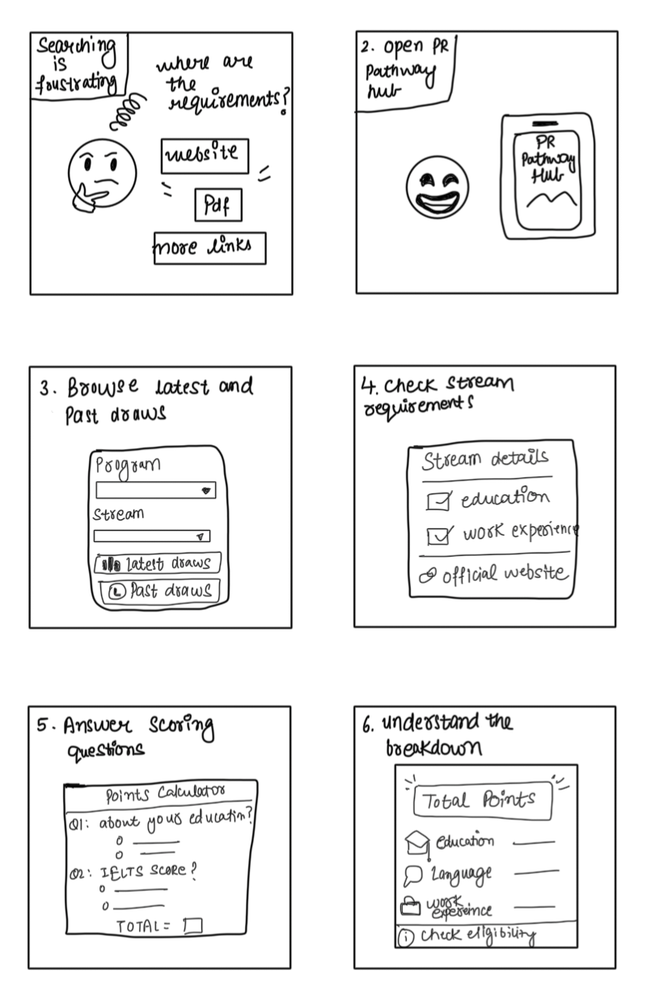

---

## Part 4: Site Map and Wireframes

### 4.1 Site map
> A Mermaid diagram (GitHub draws it). Replace the example.

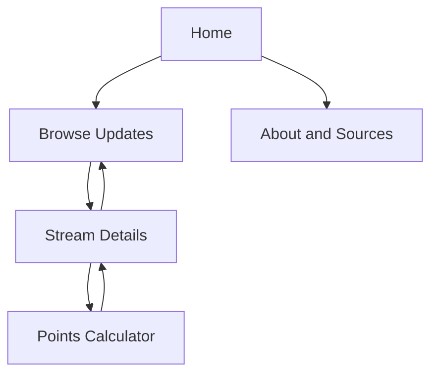

### 4.2 Wireframes
> Four images: Home and core page, each on a phone-width and a desktop-width screen. Real words, no colour. Embed them.

**Home, phone:** 	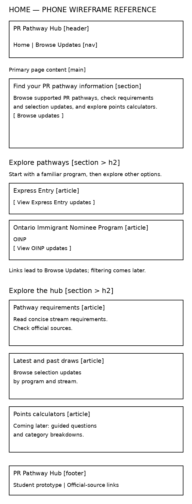
**Home, desktop:** 	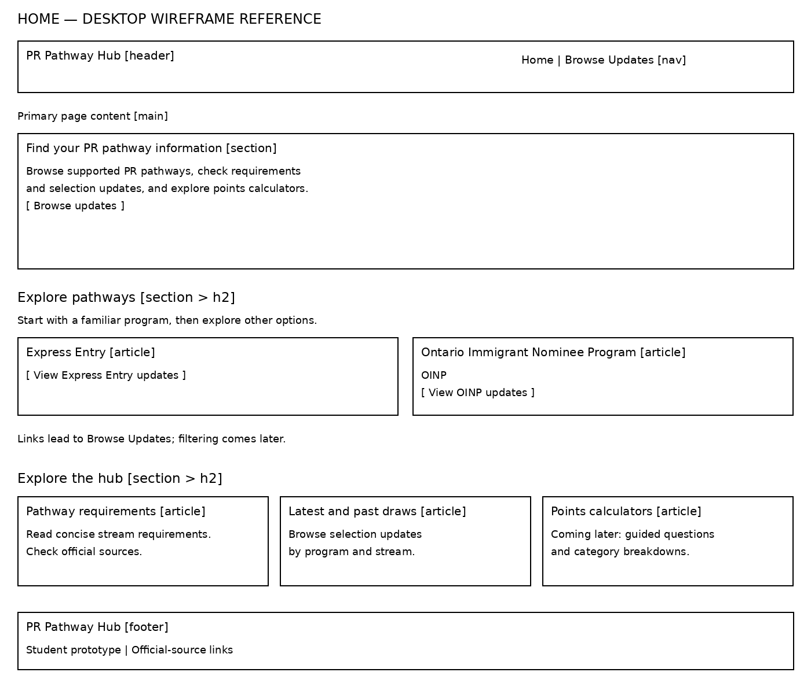
**Core page, phone:** 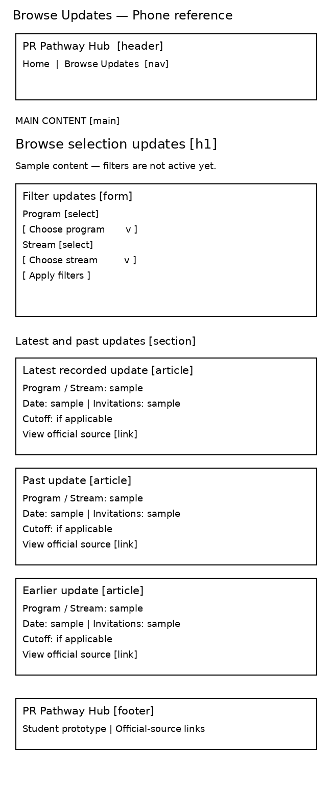
**Core page, desktop:** 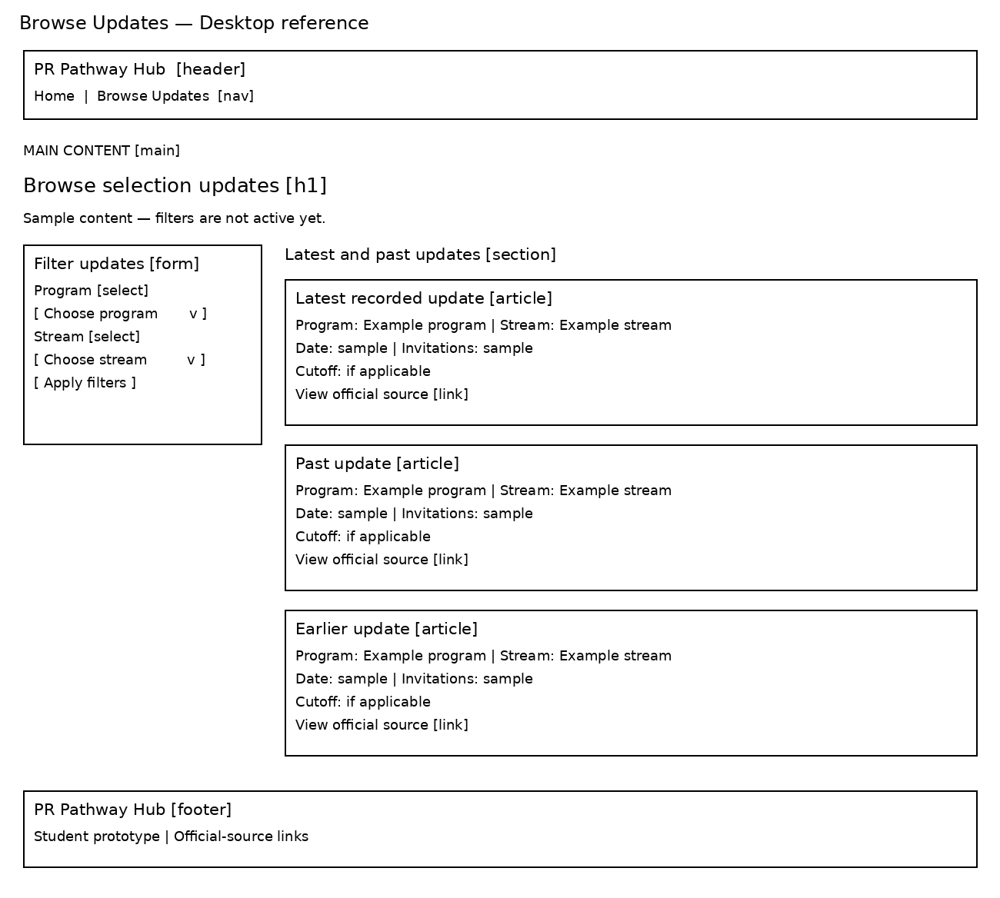

### 4.3 Annotations
> For each region of each page, name the HTML element and say why.

**Home page**

| Region | HTML element | Why this element |
|---|---|---|
| Site name and top area | header | Introduces the website. |
| Main navigation | nav | Groups links to Home and Browse Updates. |
| Main content | main | Identifies the page’s primary content. |
| Introduction and main action | section | Groups the heading, introduction and Browse Updates link. |
| Feature overview | section | Groups the three related feature cards under one heading. |
| Individual feature card | article | Describes one feature that can be understood on its own. |
| Bottom information | footer | Holds the prototype notice and source information. |

**Core page**

| Region | HTML element | Why this element |
|---|---|---|
| Site name and top area | header | Keeps the site identity consistent across pages. |
| Main navigation | nav | Provides links between the two built pages. |
| Main content | main | Contains the filters and selection updates. |
| Page introduction | section | Groups the page heading, explanation and prototype notice. |
| Program and stream filters | form | Groups labelled controls for choosing a program and stream. |
| Latest and past updates | section | Groups the selection results under a descriptive heading. |
| Individual selection update | article | Presents a self-contained update with its date, details and source link. |
| Bottom information | footer | Holds the prototype notice and source information. |

### 4.4 Five-second test
- **Who I tested (role only):** Work permit holder in Canada researching permanent residence pathways.
- **What they said the page is for, and what they would do first:** They understood it as a website that brings PR pathway information together for people inside and outside Canada. They would first click a pathway they already knew, then explore other options.
- **What I changed because of it (or why I changed nothing):** Their response suggested that familiar pathway names would help users get started. I added clearly named pathway links to the Home wireframe so users could choose a familiar option before exploring others.

---

## Part 5: Design Decisions

### 5.1 Mood
- **Three words:** Clear, calm, organized.
- **Why they fit my persona:** Aman wants to find relevant information without feeling overwhelmed. Clear headings, readable text and consistent layouts will help him scan requirements and draw results on his phone. A calm design will keep the focus on the information and his next action.

### 5.2 Palette

| Role | Variable | Hex |
|---|---|---|
| Page background | `--color-bg` | #F8FAFC |
| Card and header surface | `--color-surface` | #FFFFFF |
| Body text | `--color-text` | #1E293B |
| Headings and links | `--color-primary` | #12304A |
| Buttons and highlights | `--color-accent` | #0F766E |
| Button hover | `--color-accent-dark` | #115E59 |
| Borders | `--color-border` | #64748B |
| Secondary text | `--color-muted` | #475569 |

### 5.3 Contrast table
> At least six real pairs. Every normal-text pair must be 4.5 : 1 or better (3 : 1 for large text). Use https://webaim.org/resources/contrastchecker/

| Text colour | On | What it is | Ratio | Passes? |
|---|---|---|---|---|
| #1E293B | #F8FAFC | Body text on the page | 13.98:1 | Yes |
| #12304A | #FFFFFF | Heading on a card | 13.57:1 | Yes |
| #FFFFFF | #0F766E | Button text | 5.47:1 | Yes |
| #FFFFFF | #115E59 | Button text on hover | 7.58:1 | Yes |
| #475569 | #FFFFFF | Muted text on a card | 7.58:1 | Yes |
| #12304A | #F8FAFC | Links on the page background | 12.97:1 | Yes |

### 5.4 Type and spacing
- **Heading font stack:** "Segoe UI", Arial, sans-serif
- **Body font stack:** "Segoe UI", Arial, sans-serif
- **Type scale (`h1`, `h2`, `h3`, body, in rem):** h1: 2rem; h2: 1.5rem; h3: 1.25rem; body: 1rem
- **Spacing unit:** 0.5rem, with multiples used for gaps, padding and margins.
- **Corner radius:** 0.5rem

### 5.5 Pace check
> Halfway through your time, run `git log --format='%ad' --date=short | sort -u | wc -l`. You need commits on at least four different days.

```text
2
```

---

## Part 6: Build the Structure (HTML)

### 6.1 Build table
> Match the regions from Part 4 to what you built.

| Wireframe region | Element in my HTML | File |
|---|---|---|
| Site identity and navigation | header and nav | site/index.html and site/updates.html |
| Home introduction | main > section with h1 | site/index.html |
| Named pathway cards | section > ul > li > article | site/index.html |
| Feature cards | section > ul > li > article | site/index.html |
| Filter controls | form > fieldset with labelled select elements | site/updates.html |
| Latest and past update groups | section with nested program sections | site/updates.html |
| Individual selection updates | ul > li > article with dl | site/updates.html |
| Bottom information | footer | site/index.html and site/updates.html |

### 6.2 Checks
- [✓] Both pages have exactly one `h1` and headings in order
- [✓] Both pages have the viewport meta tag and a unique `<title>`
- [✓] The `nav` links to both pages and marks the current one with `class="active"`
- [✓] There is a list of repeated items, each an `article`
- [✓] The form has a `label`, `id` and `name` for every control
- [ ] Informative images have real alt text and decorative ones use `alt=""`. Neither page currently contains images, so alt text is not applicable.
- [✓] No lorem ipsum anywhere
- [✓] I used at least one absolute, one relative and one same-page link

### 6.3 Validator results
- **Home page:** 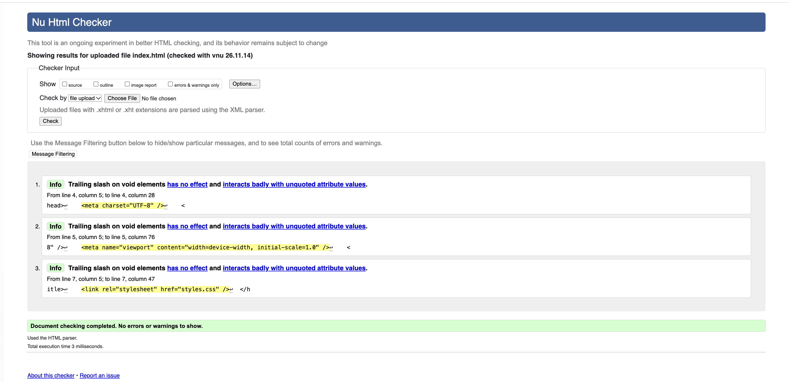
- **Core page:** 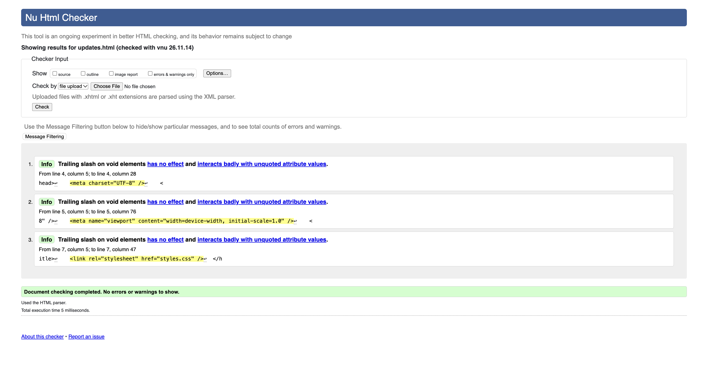

**Errors I met and fixed (at least one):** Both pages passed validation with no errors or warnings on the first check. The validator displayed informational notices about trailing slashes on meta and link elements.

---

## Part 7: Style It (CSS)

### 7.1 Match table
> Compare the finished pages with your wireframes.

| Page | What matches | What changed, and why |
|---|---|---|
| Home | The introduction, named pathway links, feature cards and footer follow the updated wireframes. Cards stack on phones and form columns on larger screens. | I added an About this prototype section to explain which features are planned and distinguish points from eligibility. |
| Core page | Filters appear above results on phones and beside results on desktop. Updates are grouped by program. | I added clear fictional-example labels and explanatory text so sample entries cannot be mistaken for verified draw results. |

### 7.2 Checks
- [x] Every colour, font, spacing and radius comes from `:root`
- [x] No `!important`, no inline `style`
- [x] Mobile first, with at least two `min-width` media queries
- [x] Flexbox is used for the header and nav, and Grid for the cards
- [x] `.btn` and `.card` (or my own reusable classes) are used everywhere
- [x] There is no sideways page scroll at 375px
- [x] The page still looks decent with Google Fonts blocked


### 7.3 Contrast re-check
**Pairs I re-tested on the built page, and any I had to change:** I rechecked body text, card headings, button text, hover button text, muted card text and page links using the colours applied in the stylesheet. Their contrast ratios remain those recorded in Part 5.3, so no colour changes were needed.


### 7.4 CSS validator
**What the W3C CSS Validator said (and whether any warning matters):** The W3C CSS Validator reported no errors and four warnings. Three warnings concern its inability to statically check CSS variables. The fourth notes that the button hover background and border have the same colour, which is intentional. These warnings do not require changes.

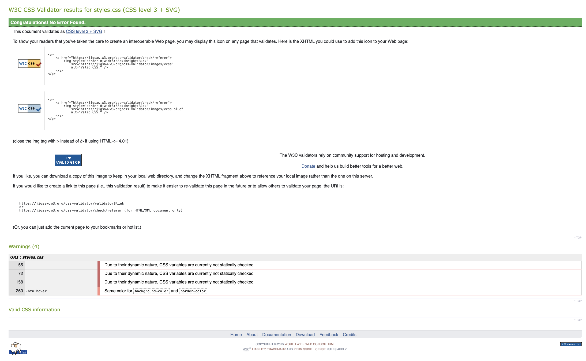

### 7.5 Screenshots
> Embed them: `screenshots/home-375.png`, `screenshots/home-1280.png`, `screenshots/core-375.png`, `screenshots/core-1280.png`.

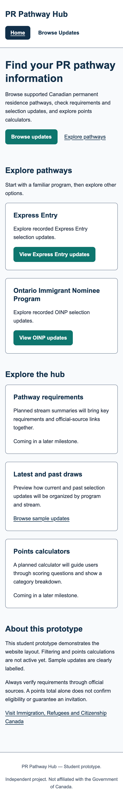

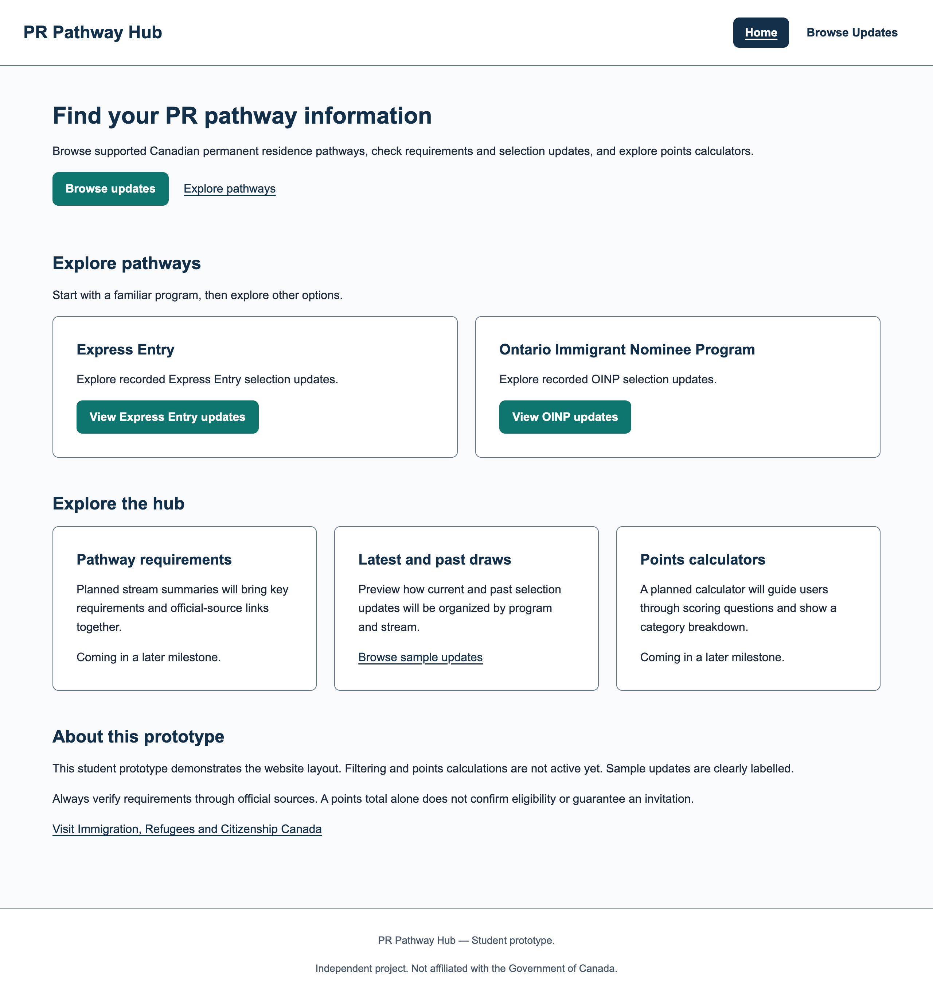

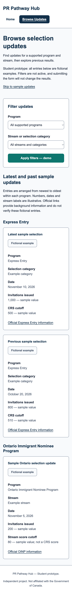

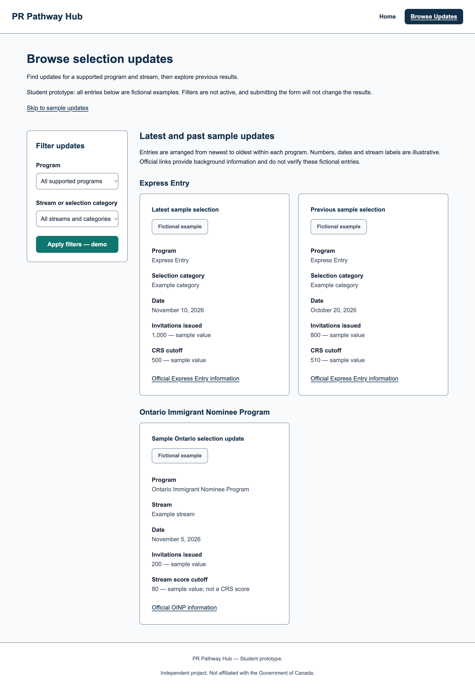

---

## Part 8: Git and GitHub

**Repository:** https://github.com/...
**Issue #1 (closed):** https://github.com/rishabhssworld/studio-project-1/pull/6
**Issue #2 (closed):** https://github.com/...
**Merged Pull Request for HTML:** https://github.com/...
**Merged Pull Request for CSS:** https://github.com/...
**Release v0.1.0:** https://github.com/...

```text
(git log --oneline | wc -l)
```
```text
(git log --format='%ad' --date=short | sort -u | wc -l)
```
```text
(git branch -a)
```
```text
(git log --oneline --graph --all | head -20)
```

---

## Part 9: Reflection

> Two to four sentences each, about your own project.

1. **From idea to problem:** YOUR ANSWER HERE
2. **Evidence:** YOUR ANSWER HERE
3. **The hardest decision:** YOUR ANSWER HERE
4. **Design to code:** YOUR ANSWER HERE
5. **Risks for the next milestones:** YOUR ANSWER HERE
6. **Tools (including any AI tool, and what I did myself):** ChatGPT helped generate a storyboard reference, and I drew the submitted version myself. Took help from ChatGPT to make wireframes

### Self-assessment

| Area | Points | My score | One line of justification |
|---|---|---|---|
| Problem definition and evidence | 15 | | |
| Scope and data | 10 | | |
| Storyboard | 10 | | |
| Wireframes and site map | 10 | | |
| Design decisions | 5 | | |
| HTML | 15 | | |
| CSS and responsiveness | 15 | | |
| Git and GitHub | 15 | | |
| Reflection and completeness | 5 | | |

## Bonus (optional)

- **Usability test (+3):** who I tested (roles), what happened, what I changed: YOUR ANSWER HERE
- **Live site (+2):** https://...
